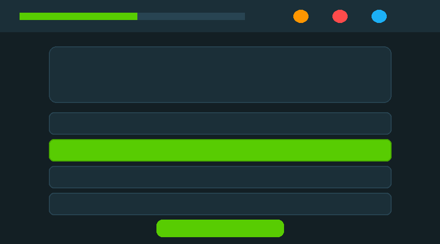

# 🦉 ENEM Lingo — O Duolingo do ENEM

<div align="center">


<p align="center">
  <b>Uma plataforma interativa de gamificação educacional focada nas questões mais recorrentes do ENEM.</b><br>
  Estude no formato Duolingo com sistema de ofensivas (streaks), vidas, gemas, feedback sonoro e progressão diária.
</p>

<p align="center">
  <a href="https://nycolas007el.github.io/Enem-Lingo/" target="_blank">
    
  </a>
</p>

<p align="center">
  
</p>

[Visão Geral](#-visão-geral) •
[Demonstração Online](#-demonstração-online) •
[Funcionalidades Gamificadas](#-funcionalidades-gamificadas) •
[Áreas de Conhecimento](#-áreas-do-conhecimento-cobertas) •
[Tecnologias](#-tecnologias-utilizadas) •
[Como Executar](#-como-executar-o-projeto) •
[Autor](#-autor)

</div>

---

## 📖 Visão Geral

O **ENEM Lingo** transforma a preparação para o Exame Nacional do Ensino Médio em uma experiência dinâmica, divertida e engajante. Inspirado na mecânica visual e motivacional do **Duolingo**, o aplicativo organiza questões reais e simuladas por áreas do conhecimento, divididas de acordo com o calendário oficial do exame (**Dia 1** e **Dia 2**).

---

## 🎮 Funcionalidades Gamificadas

- 🔥 **Ofensiva Diária (Streak):** Sistema de foguinho persistente via `localStorage` que estimula a consistência nos estudos todos os dias.
- ❤️ **Sistema de Vidas & Gemas:** Gerenciamento de tentativas para simular o desafio real e recompensas em gemas a cada acerto.
- 🎲 **Embaralhamento Inteligente (Fisher-Yates):** As 5 alternativas (A, B, C, D, E) são sorteadas de forma dinâmica e justa a cada rodada.
- 💡 **Explicações Detalhadas (Gabarito Comentado):** Feedback imediato a cada resposta, esclarecendo o motivo do acerto ou erro para consolidar o aprendizado.
- 📱 **Design Mobile-First e Responsivo:** Interface otimizada tanto para telas de smartphones quanto para tablets e desktops.
- 🔊 **Feedback Visual e Interativo:** Animações fluidas, efeitos sonoros de conquista e tipografia estilizada (`Nunito`).

---

## 📚 Áreas do Conhecimento Cobertas

O banco de questões foi estrategicamente selecionado com base nos conteúdos de **maior incidência histórica** da prova:

### 🗓️ Dia 1
- **Linguagens e Códigos:** Estratégias textuais, funções da linguagem, figuras de linguagem e variação linguística.
- **Ciências Humanas:** Era Vargas (trabalhismo, DIP), Cidadania, Direitos Humanos, Divisão dos Poderes (Montesquieu) e Geopolítica.

### 🗓️ Dia 2
- **Ciências da Natureza:**
  - *Biologia:* Ecologia, Magnificação Trófica e Bioacumulação.
  - *Física:* Ondulatória, Efeito Doppler, Óptica e Eletrodinâmica.
  - *Química:* Termoquímica, Equilíbrio Químico e Fontes Limpas de Energia.
- **Matemática e suas Tecnologias:** Matemática Básica, razão, proporção, geometria espacial, funções e escalas cartográficas.

---

## 🛠️ Tecnologias Utilizadas

- **HTML5 Semântico:** Estruturação acessível e otimizada para web e mobile.
- **CSS3 Moderno:** Paleta inspirada no Duolingo dark mode, animações, transições e variáveis CSS (`CSS Custom Properties`).
- **JavaScript Moderno (ES6+):**
  - Algoritmo de Fisher-Yates para randomização de alternativas.
  - Manipulação dinâmica do DOM.
  - Persistência de dados com `localStorage` (ofensivas, recordes e progresso).

---

## 📁 Estrutura de Arquivos

```text
Enem-Lingo/
├── index.html       # Estrutura visual, componentes e estilização da interface
├── questions.js     # Banco de questões categorizadas por área e dia da prova
└── README.md        # Documentação completa do projeto
```

---

## 🚀 Como Executar o Projeto

Não é necessária nenhuma instalação complexa ou servidor backend:

1. **Clone este repositório:**
   ```bash
   git clone https://github.com/nycolas007el/Enem-Lingo.git
   cd Enem-Lingo
   ```

2. **Abra o projeto:**
   - Dê um duplo clique no arquivo `index.html` para abrir diretamente no seu navegador; **ou**
   - Execute com a extensão **Live Server** no VS Code.

---

## 👨‍💻 Autor

Desenvolvido por **Nycolas**!

[](https://github.com/nycolas007el)
[](https://www.linkedin.com/in/nycolas-moreira-286206343/)
